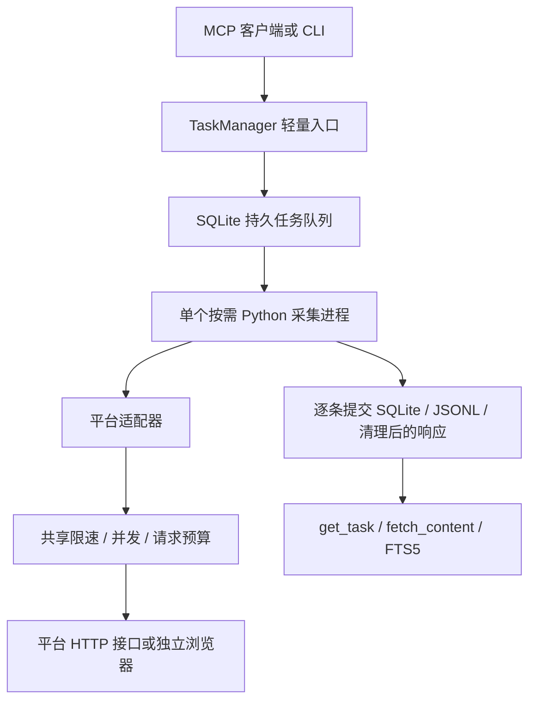

# 架构与边界

本工程将搜索后端与 ChatGPT 产品接入分开。MCP 是标准协议能力；普通 Chat 新对话是否发现工具属于客户端与账户的独立验收条件。

`server.py` 使用官方 MCP Python SDK 1.x FastMCP，锁定 `<2`，本机实际版本 1.30.0。1.x 属维护线，选择它是为了保持简单 stdio 客户端兼容；未来升级 2.x 要重新跑协议和客户端验收。MCP 使用 stdio。登录面板按需监听本机回环地址，浏览器平台用独立会话处理登录及验证。

`manager.py` 对单资料目录持有跨平台文件锁，一个服务内只运行一个工作进程。8 个待执行任务先进先出。进程退出后检查数据库状态；意外退出标记 `WORKER_EXITED`。服务重开将残留 running 标记 interrupted，允许显式恢复。关闭服务会终止并等待工作进程；额外父进程监控处理网关突然退出。

任务状态为 queued/running/completed/partial/failed/cancelled/interrupted。SQLite 每条采集内容独立提交，取消、超时、风控或某个视频失败都不会回滚之前的资料。恢复复用持久缓存并重新扫描候选、更新相同视频记录，并不保证从每一 HTTP 字节或评论游标精确续传。

`cc_subtitles.py` 是独立字幕适配器，通过现有 Transport 获取 WBI/标准播放器轨道并核对 BV/aid/CID。它复用 `vendor/cc_ext.py` 的刷新 URL、双次指纹、覆盖时长及语言检查，并增加完整正文哈希比较和分P隔离缓存。只有通过检查的轨道进入既有 JSON 归档和 SQLite FTS5，数据库与 MCP 工具签名没有变化；`fetch_content` 字幕行额外包含 BV、CID 和轨道 ID。

`bilibili.py` 负责平台差异：WBI 原生搜索、视频元数据、现有字幕、两种评论排序及有预算的楼中楼、当前可见 XML 弹幕池。WBI 签名算法复用 MIT 上游并增加密钥校验和串行刷新。没有引入整个上游 MCP 的写账户能力。`http.py` 统一管理包括重试在内的请求次数、并发、限速、5MB 响应上限、TLS 与域名允许范围。

缓存按接口与参数划分；涉及登录的 API 缓存按会话哈希隔离。会话值只在 auth 本机文件和 httpx 内存 Cookie jar 中。Cookie 域限制为 `.bilibili.com`，不会向字幕 CDN 发送。字幕下载 URL 只在内存使用，不进入归档。HTTP 错误不向调用方回显原始异常、响应头或 Cookie。

SQLite 使用 WAL 与事务；`items` 是各任务最新深度快照，`candidates` 保存轻量发现，`cache` 保存分接口有效数据，FTS5 索引标题与内容。JSONL 是追加历史记录，断电可能留下最后一条不完整记录，主数据库仍是权威数据源。FTS5 使用 unicode61，英文词面检索可用，中文分词和语义匹配尚未实现。

多平台扩展应新增独立适配器和契约测试，明确搜索原生性、认证、覆盖与退出方式后，才把平台加入模型枚举和 ping。不能仅增加平台名称而声称已经支持。

## 0.2.0 研究与能力发现

`capabilities.py` 提供只读实现目录，按请求 schema 可接收的平台过滤可用登记，并从同一请求模型导出预算与深度默认值。它不探测登录和网络，也不包含未来平台的虚假能力。原 ping 保留兼容字段，平台名称由同一目录产生。

插件根 `skills/private-search-research/` 是研究决策层：不维护支持名单，由运行时报告驱动选源、检索、筛选、按需读取与信息增益停止。原 backend / worker / SQLite 路径不变，安装器复制这套工作流及引用资源。新增平台仍需独立适配器、schema 和路由接入、能力登记与实测；此后 Skill 沿用通用契约。
